# AI OS - UI / UX QA report (desktop app)

**Date:** 30 Oct 2026 | **Build:** 6.0.0, `electron .` in `live-dev` mode | **Window:** 1426 x 850 CSS px at 125 % (plus a 1024 x 720 minimum-size check)
**Theme coverage:** light, dark + Deloitte (spot checks) | **Screenshots:** [`screenshots/`](./screenshots) (every finding links to one)

Nothing in the app was changed. This report is for your approval; no fixes have been made.

## How this was tested

- The real desktop app (Electron) was launched with a **throw-away profile** and every data folder redirected to a scratch directory, so your real PMO inbox, staff data and OneDrive were never touched. The local AI ran as the built-in **test stub** (`PMO_AI_STUB=1`) so proposals were instant and nothing was sent anywhere.
- **Dummy data added first:** 12 employees (long names, accents, apostrophes, 7 skills, empty fields), 8 time-off requests (all types and statuses, one with a long reason), 7 PMO inbox messages (action request, FYI, urgent, French text with emoji, blocked domain, long sender name), 8 to-dos (overdue, today, long 200-char title, emoji, 30-line description, waiting, no date), 1 RAID item, 1 note, plus first-run setup through the wizard.
- Every app, dialog and tab reachable in the dock was opened and used: Dashboard, PMO To-Do (Setup, Review Queue, To-Do, Board, Calendar, Filtered, Reports, Settings), Tasks (Workflows, Run, Details, History, Schedule, Packs), Staff (Directory, Add, Edit, Shift roster, Time off, Offboarded, Insights), Templates, PMO Toolkit (RAID log), Files, Notes, Browser, App Store, Settings (quick menu and All settings), command bar, global search (Ctrl+K), window drag / resize / maximise, themes.
- Driven over the Chrome DevTools Protocol (real mouse and keyboard events), screenshots captured from the live window.

## Summary

| Severity | Count | Meaning |
| --- | --- | --- |
| High | 3 | Breaks a flow or silently loses data |
| Medium | 17 | Confusing, misleading or hard to use |
| Low | 24 | Polish and small inconsistencies |
| Good | 9 | Things that work well and should be kept |

**Top 5 to fix first:** QA-01 (Tasks fails first time), QA-02 (setup accepts malformed addresses so mail is silently discarded), QA-03 (global search says "Nothing matches" while still loading), QA-04 (calendar looks empty), QA-05 (see-through dialogs).

---

## High

### QA-01 - Tasks fails to open the first time ("Couldn't start the Tasks engine") - Bug
**Where:** Tasks, first open | **Screenshot:** [45-tasks.png](./screenshots/45-tasks.png)

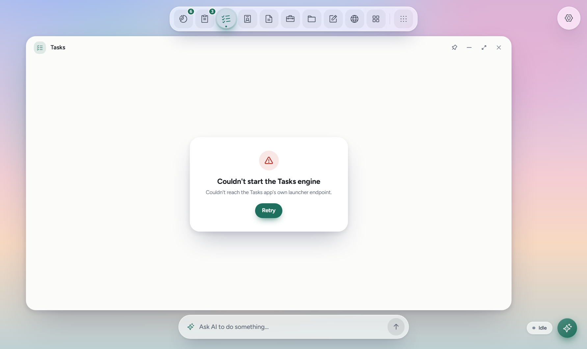

Opening Tasks right after launch shows a dead-end card: *"Couldn't reach the Tasks app's own launcher endpoint."* The log shows `POST /api/tasks-engine/start 404` (the route was still compiling) even though the engine itself was already running on port 8001. Retry worked the second time ([47-tasks-ready.png](./screenshots/47-tasks-ready.png)).
**Suggested fix:** retry automatically with back-off for ~10 s before showing an error, and say what actually failed (engine starting / HTTP 404) rather than "launcher endpoint".
*Note: seen in `live-dev`, where routes compile on first use. The installed (production) build is likely faster, but the failure message and the lack of an auto-retry are the same.*

### QA-02 - PMO setup accepts values that are not email addresses or domains, then every mail is filtered - Bug
**Where:** PMO To-Do > Setup wizard, Settings, Filtered | **Screenshots:** [27-pmo-wizard-3.png](./screenshots/27-pmo-wizard-3.png), [32-pmo-settings.png](./screenshots/32-pmo-settings.png), [31-pmo-filtered.png](./screenshots/31-pmo-filtered.png)

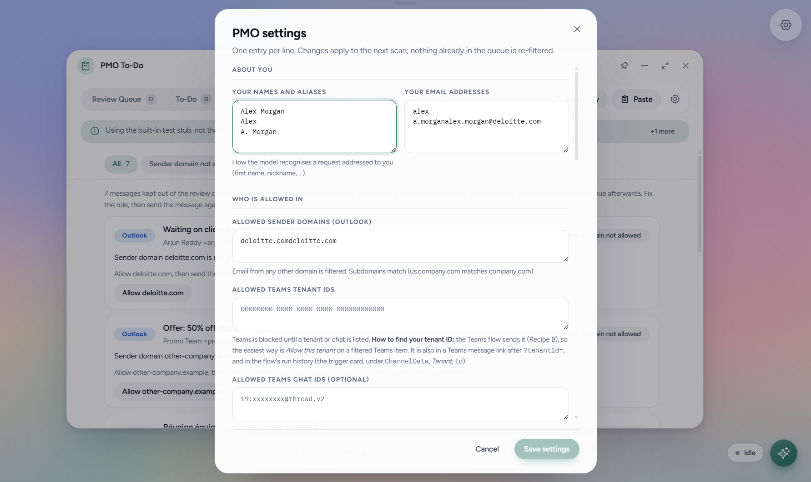
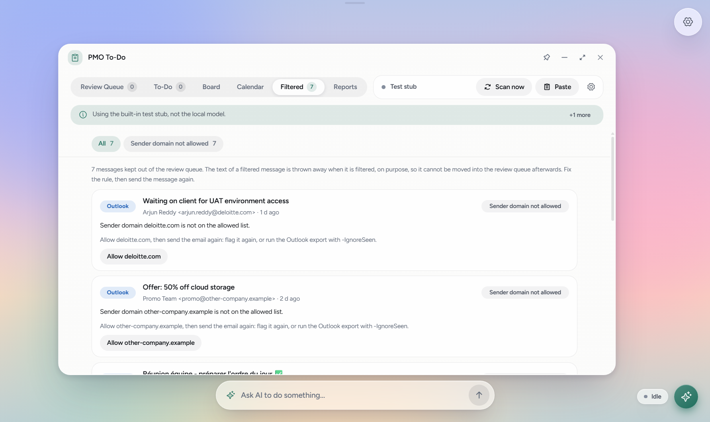

The wizard took `Alex,A.Morgan` as the email list and appended my typing to the pre-filled domain (`deloitte.com` + `deloitte.com`). The saved settings now contain emails `alex` and `a.morganalex.morgan@deloitte.com` and the allowed domain `deloitte.comdeloitte.com`. All 7 test messages from `deloitte.com` were then filtered with *"Sender domain deloitte.com is not on the allowed list"*, and the card offers "Allow deloitte.com" but never shows what the list contains, so the user cannot see why. Filtered messages are discarded (they "cannot be moved into the review queue afterwards"), so one typo silently loses mail.
**Suggested fix:** validate each entry (email / domain format) with a per-line error, as the Staff "Add employees" dialog already does ([09-staff-add-invalid2.png](./screenshots/09-staff-add-invalid2.png)); replace a pre-filled value instead of appending; show the current allowed list in the Filtered card.

### QA-03 - Global search says "Nothing matches" while it is still loading - Bug
**Where:** Ctrl+K | **Screenshots:** [81b-ctrlk-kafka-immediate.png](./screenshots/81b-ctrlk-kafka-immediate.png), [81d-ctrlk-todo.png](./screenshots/81d-ctrlk-todo.png), [81e-ctrlk-todo-25s.png](./screenshots/81e-ctrlk-todo-25s.png)

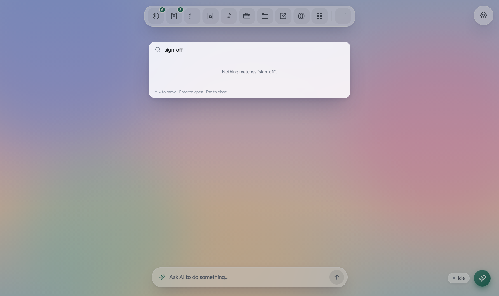
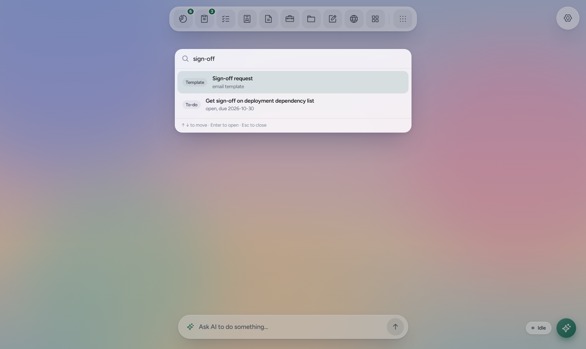

Searching "sign-off" a few seconds after opening shows *"Nothing matches 'sign-off'."* The same search after waiting ~25 s returns the template and the to-do "Get sign-off on deployment dependency list". People and apps appear instantly; to-dos, templates and PMO tool records load in the background (`GlobalSearch.tsx` loads them once when the box opens) with no loading indicator and no refresh when they arrive, so the empty state is wrong.
**Suggested fix:** show "Searching to-dos, templates, records..." until loading finishes and re-run the query when data arrives.

---

## Medium

### QA-04 - Calendar opens with the current week cut off, so it looks empty - Bug
**Screenshots:** [42-pmo-calendar.png](./screenshots/42-pmo-calendar.png), [42b-pmo-calendar-scrolled.png](./screenshots/42b-pmo-calendar-scrolled.png)

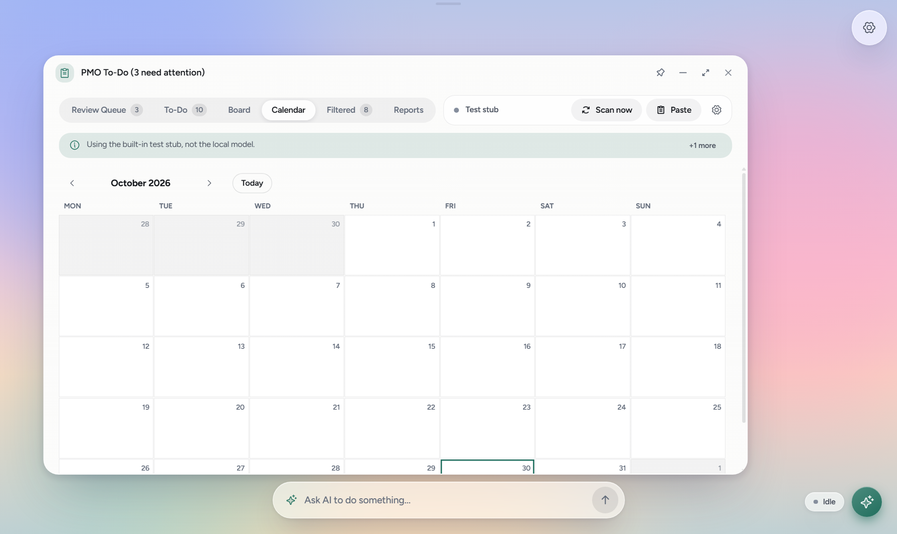
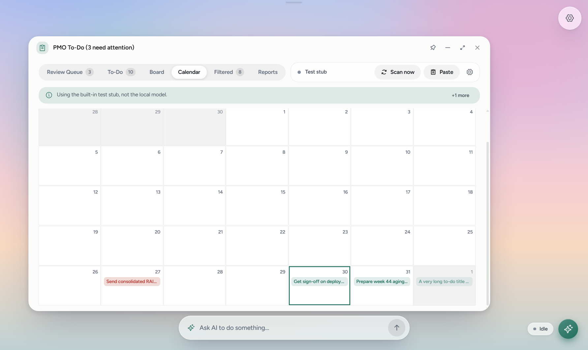

The month grid is six rows tall but only ~5.3 fit. Today's row (26 Oct - 1 Nov), which holds all 8 dated to-dos, is cut off at the bottom, so the calendar looks empty until the user finds the scrollbar. **Fix:** scroll the current week into view on open and/or shrink the rows.

### QA-05 - Dialog panels are slightly see-through; page text ghosts through - Bug
**Screenshots:** [07-staff-add.png](./screenshots/07-staff-add.png), [09-staff-add-invalid2.png](./screenshots/09-staff-add-invalid2.png), [44-pmo-todo-detail.png](./screenshots/44-pmo-todo-detail.png), [48-tasks-run.png](./screenshots/48-tasks-run.png), [49-tasks-details.png](./screenshots/49-tasks-details.png), [57-raid-validate.png](./screenshots/57-raid-validate.png)

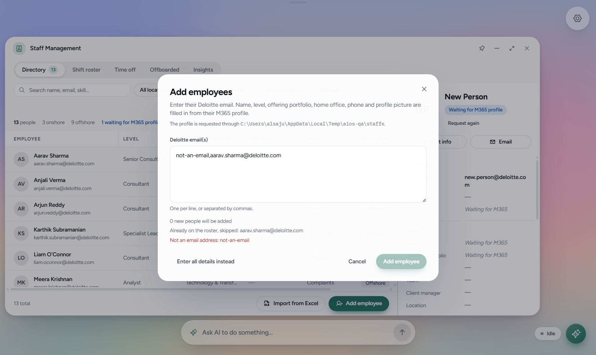

Behind modals the table / list text shows through the white panel ("Technology & Transf...", "Offshore", etc.), which looks like a rendering glitch and lowers legibility. **Fix:** make dialog surfaces opaque (or blur what is behind them).

### QA-06 - Staff directory: email wraps mid-word - Bug
**Screenshot:** [04-staff-directory.png](./screenshots/04-staff-directory.png), [93-min-staff.png](./screenshots/93-min-staff.png)

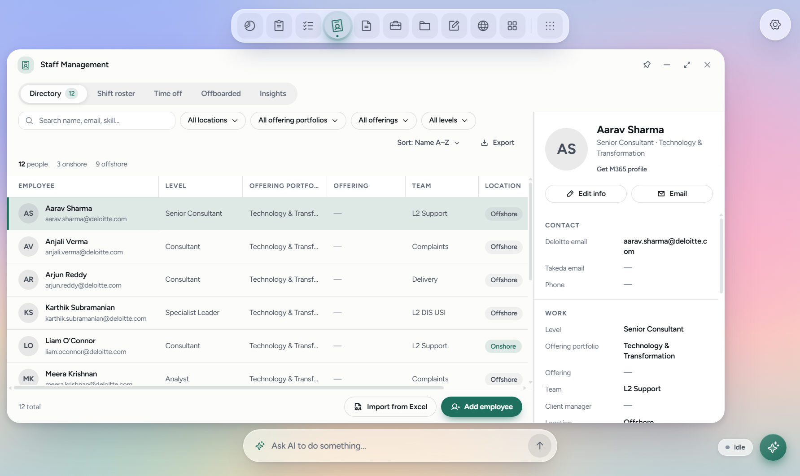

The detail pane breaks `aarav.sharma@deloitte.c` / `om`, which reads like a typo and is hard to copy. **Fix:** keep the address on one line (truncate with a tooltip) or allow breaks only after `@` / `.`.

### QA-07 - Staff directory: ~5 rows visible, empty "Offering" column, horizontal scrollbar - Improvement
**Screenshots:** [04-staff-directory.png](./screenshots/04-staff-directory.png), [93-min-staff.png](./screenshots/93-min-staff.png) (at minimum window size only 3 rows)

Filters, sort, count and a wide detail pane leave about five rows. "Offering portfolio" is truncated, "Offering" shows "-" for every person, and a horizontal scrollbar sits under the table. **Fix:** hide empty columns, collapse the detail pane until a row is selected.

### QA-08 - Shift roster: legends and a wrapped toolbar leave room for 3 people - Improvement
**Screenshot:** [18-staff-roster-data.png](./screenshots/18-staff-roster-data.png), [11-staff-roster.png](./screenshots/11-staff-roster.png)

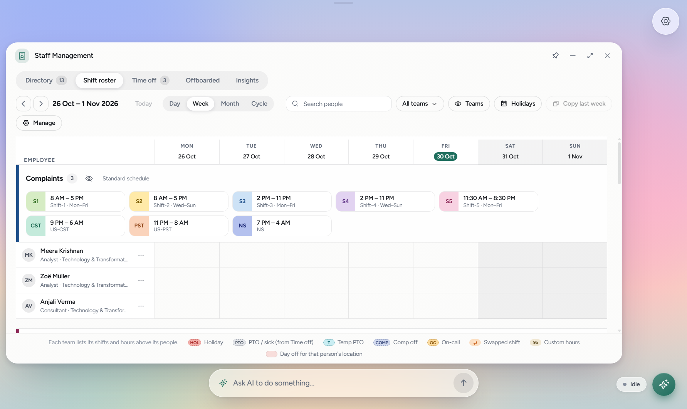

Each team prints a two-row legend of 7 shift cards, the toolbar wraps so "Manage" sits alone, and a second legend repeats at the bottom. Only 3 people are visible before scrolling. The "Today" button is so pale it looks disabled. **Fix:** collapsible legend, one-row toolbar.

### QA-09 - Insights > Capacity: help text points at a control that is not there - Bug
**Screenshot:** [14-staff-insights.png](./screenshots/14-staff-insights.png), [94-min-staff-insights.png](./screenshots/94-min-staff-insights.png)

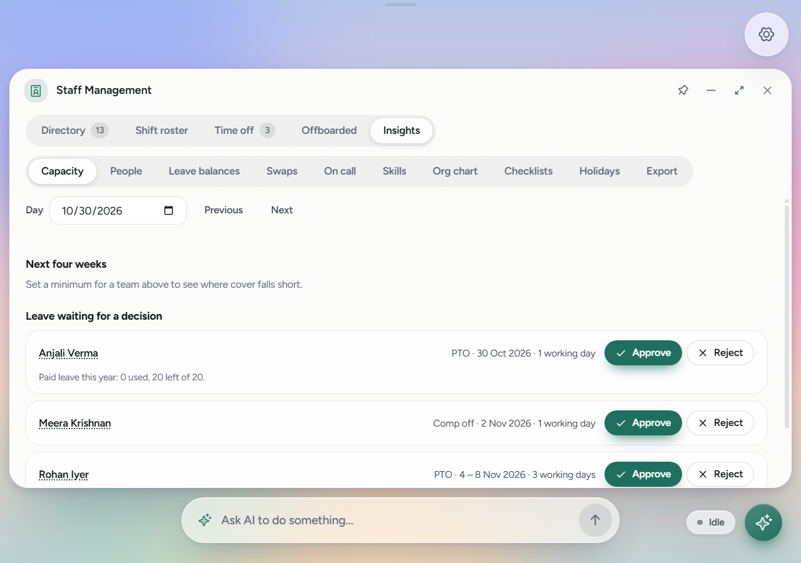

"Set a minimum for a team above to see where cover falls short." - nothing above sets a minimum. "Previous / Next" are unstyled text, and the native date picker looks unlike the rest of the app.

### QA-10 - Insights > Org chart is a text list, not a chart - Improvement
**Screenshot:** [21-ins-org.png](./screenshots/21-ins-org.png)

Everything sits under one heading *"No client manager (13)"* followed by comma-separated names - no hierarchy, avatars or counts, and the first thing the user reads looks like an error. **Fix:** a real tree, or rename the tab "Teams".

### QA-11 - PMO proposals are titled with the greeting ("Hi,", "Bonjour,", "Rohan,") - Improvement
**Screenshots:** [34-pmo-queue.png](./screenshots/34-pmo-queue.png), [35-pmo-detail.png](./screenshots/35-pmo-detail.png)

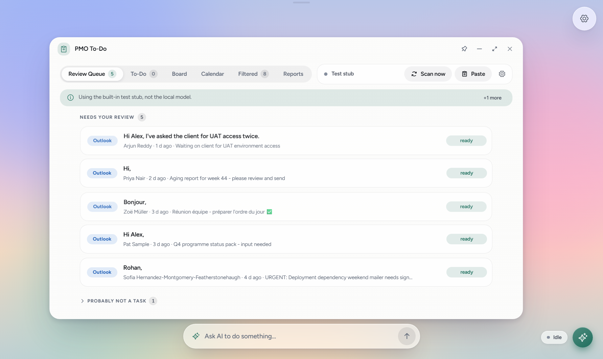

With the AI stub every row is titled with the first line of the mail and all are marked "ready", while the useful subject is in small grey text. The same would happen if the model fails. **Fix:** fall back to the subject line and show an explicit "AI could not structure this" state.

### QA-12 - Proposal owner defaults to the Windows account name, not the name set up - Bug
**Screenshot:** [35-pmo-detail.png](./screenshots/35-pmo-detail.png)

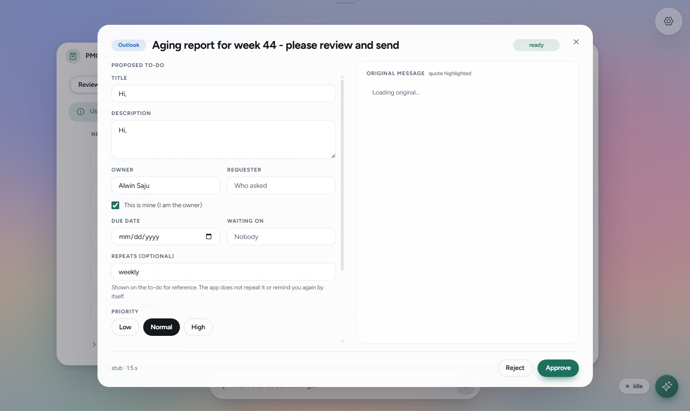

Setup said the user is "Alex Morgan", but the review dialog pre-fills Owner = "Alwin Saju" with "This is mine" ticked, so approved to-dos can carry the wrong owner unless the reviewer notices.

### QA-13 - To-Do tab: status chips are clipped (Waiting cut off, Snoozed / Done hidden) - Bug
**Screenshot:** [40-pmo-todo-data.png](./screenshots/40-pmo-todo-data.png)

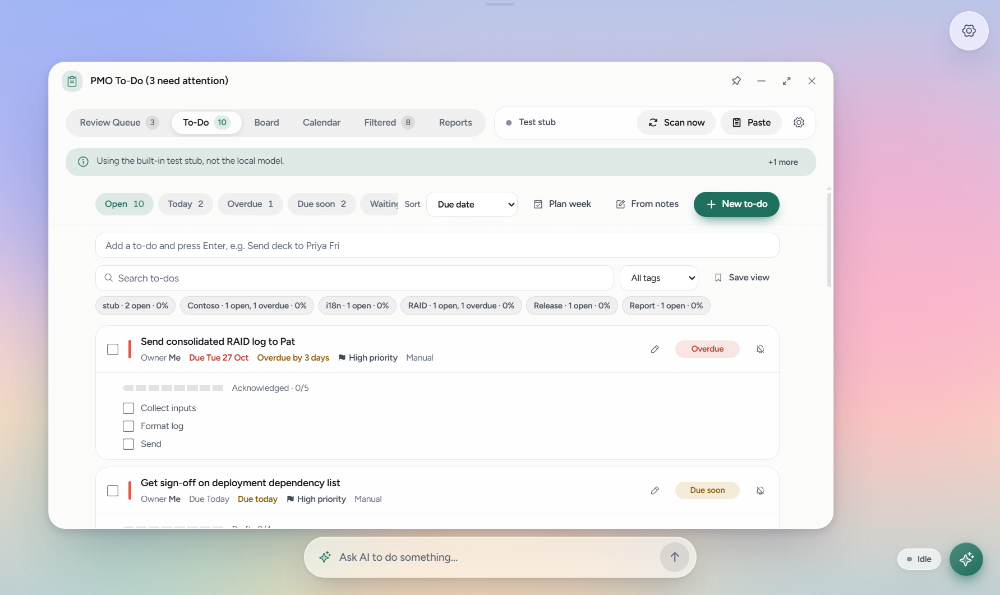

The chip row (Open, Today, Overdue, Due soon, Waiting, Snoozed, Done) overflows behind "Sort"; "Waitin" is truncated and Snoozed / Done cannot be reached at the default size. **Fix:** wrap or scroll the row.

### QA-14 - To-Do tab: four rows of controls before the first to-do - Improvement
**Screenshot:** [40-pmo-todo-data.png](./screenshots/40-pmo-todo-data.png)

Tabs + banner, chips + actions, quick-add, search/tags/save-view and a tag-stats row take ~330 px; only 1.5 cards are visible. **Fix:** merge quick-add into the header, collapse tag stats.

### QA-15 - Tasks > Details: stale tooltip stays on top of the dialog - Bug
**Screenshot:** [49-tasks-details.png](./screenshots/49-tasks-details.png)

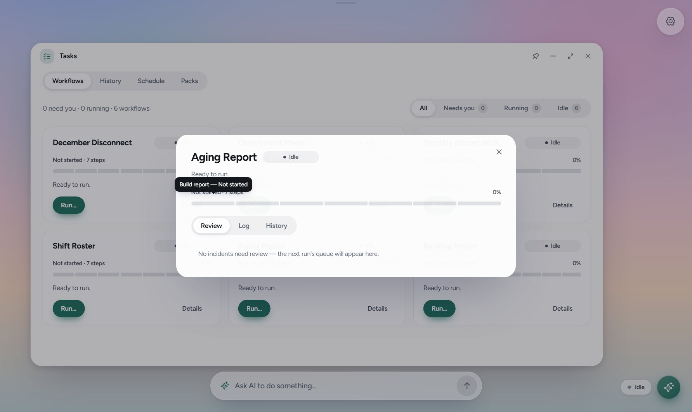

A dark "Build report - Not started" tooltip from the step bar behind the dialog stays over "Not started - 7 steps". **Fix:** close tooltips when a modal opens. The dialog is also very sparse.

### QA-16 - Templates: To / Cc inputs truncate long recipient lists - Bug
**Screenshot:** [53-templates.png](./screenshots/53-templates.png)

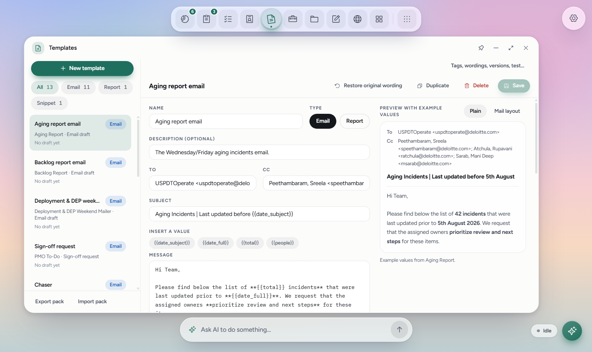

"USPDTOperate <uspdtoperate@delo" and "Peethambaram, Sreela <speethambar" are cut off in single-line inputs; the preview shows the field really holds four people. **Fix:** multi-line / chip input.

### QA-17 - PMO Toolkit > RAID log: empty list is a blank window - Bug
**Screenshot:** [55-toolkit-raid.png](./screenshots/55-toolkit-raid.png)

With 0 items there is no message, icon or "Add your first risk" prompt, and Export CSV is dimmed without explanation.

### QA-18 - RAID "Add item": error shown away from the field - Improvement
**Screenshot:** [57-raid-validate.png](./screenshots/57-raid-validate.png)

"Title is required." appears in a strip below the scrolled form; the Title field has no red outline and the form scrolls inside the dialog. **Fix:** mark the field and scroll to it.

### QA-19 - Files shows demo content ("SAMPLE FILES") - Improvement
**Screenshot:** [59-files.png](./screenshots/59-files.png)

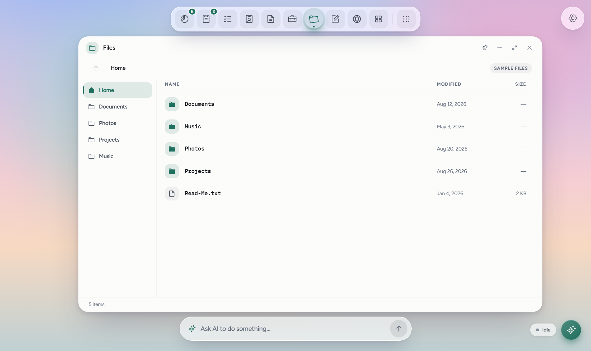

A mock file system (Documents / Music / Photos, Aug 2026 dates) that looks like a real file manager; the only hint is a small grey chip. **Fix:** connect it to a real folder or say clearly that it is a demo.

### QA-20 - Command bar: AI fallback sits on "Thinking..." for 20 s+ with no progress or cancel - Improvement
**Screenshots:** [82-cmd-ai-after.png](./screenshots/82-cmd-ai-after.png), [84-ctrlk-aarav.png](./screenshots/84-ctrlk-aarav.png)

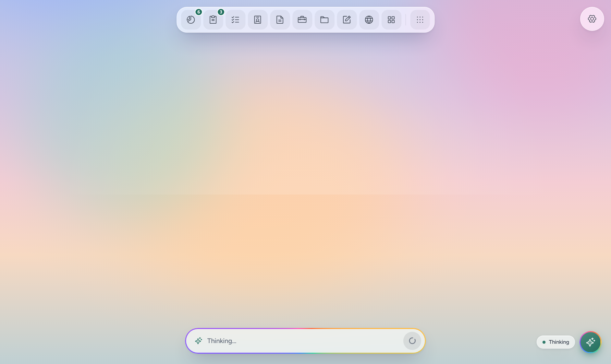

A free-form prompt ("write a haiku about mondays") shows an animated "Thinking..." bar for more than 20 s (the local model runs on the CPU). Nothing says how long it may take or that Esc cancels. **Fix:** show elapsed time and a "Stop" button.

---

## Low

| # | Area | Finding (type) | Screenshot |
| --- | --- | --- | --- |
| QA-21 | Staff > Directory | Newly added person is selected but not visible - the list stays at the top (Improvement) | [08](./screenshots/08-staff-add-invalid.png) |
| QA-22 | Staff > Directory | Toast "Started 1 checklist in Staff > Checklists." sits half outside the window and covers the detail pane; it is also unexplained (Bug) | [08](./screenshots/08-staff-add-invalid.png) |
| QA-23 | Staff > Add employees | The dialog prints an internal path ("The profile is requested through C:\\Users\\...\\staffx") (Improvement) | [07](./screenshots/07-staff-add.png) |
| QA-24 | Staff > Time off | "Model asleep" chip is unexplained; "Requested" (the total) reads like "Pending" (Improvement) | [12](./screenshots/12-staff-timeoff.png) |
| QA-25 | Staff > Time off | Revert / delete are icon-only with no confirmation affordance; the reason is truncated with no tooltip; pending items are not listed first (Improvement) | [17](./screenshots/17-staff-timeoff-data.png) |
| QA-26 | Staff > Add time off | Error is red text only; the Employee field is not outlined; the date-list format is explained only by a placeholder (Improvement) | [16](./screenshots/16-staff-timeoff-validate.png) |
| QA-27 | Dashboard | Cards are oversized for their content (Today ~300 px for two lines); "No one is overdue a nudge." reads as a typo (Improvement) | [23](./screenshots/23-dashboard.png) |
| QA-28 | PMO > Setup wizard | Pre-fills the Windows login "Alsaju" as the full name; the same subtitle repeats on all steps; "STEP 1 OF 4" is text only; content fills the top 40 % of the window (Improvement) | [24](./screenshots/24-pmo-open.png) |
| QA-29 | PMO > Settings | Teams tenant / chat-ID help takes half the dialog for Outlook-only users; collapse under "Advanced" (Improvement) | [32](./screenshots/32-pmo-settings.png) |
| QA-30 | PMO > Review proposal | "Loading original..." with an empty pane on open; the form dims with no progress after Approve (Improvement) | [36](./screenshots/36-pmo-approved.png) |
| QA-31 | PMO > To-Do detail | Footer actions are all plain text; destructive "Cancel to-do" has the same weight as "Hand over" (Improvement) | [44](./screenshots/44-pmo-todo-detail.png) |
| QA-32 | PMO > Reports | Two paragraphs of text before first use, ~60 % empty (Improvement) | [43](./screenshots/43-pmo-reports.png) |
| QA-33 | Tasks > Run | Required / .xlsx badges wrap; quick links ("Newest in Downloads", "Browse...") sit outside the drop zones; the footer "Still needed" line wraps (Improvement) | [48](./screenshots/48-tasks-run.png) |
| QA-34 | Tasks > History | "No runs match." with no filter applied; say "No runs yet" and link to Workflows (Improvement) | [50](./screenshots/50-tasks-history.png) |
| QA-35 | Tasks > Packs | Narrow, off-centre column with ~65 % of the window empty (Improvement) | [52](./screenshots/52-tasks-packs.png) |
| QA-36 | Tasks > Schedule | Six identical "Not scheduled" rows; the key caveat about "only while open" is plain grey text (Improvement) | [51](./screenshots/51-tasks-schedule.png) |
| QA-37 | Templates | Delete (red) sits next to Save; "Tags, wordings, versions, test..." looks like a caption; chips wrap leaving "Snippet 1" alone (Improvement) | [53](./screenshots/53-templates.png) |
| QA-38 | PMO Toolkit | RAID log opens as a second window offset by a few pixels, leaving a sliver of the parent (Improvement) | [58](./screenshots/58-raid-filled.png) |
| QA-39 | RAID log | Saved row has no hover / edit / delete affordance; blank date cells show no dash (Improvement) | [58](./screenshots/58-raid-filled.png) |
| QA-40 | Files | Double-click highlights the name as text (needs `user-select: none`); monospace names differ from every other app (Bug) | [61](./screenshots/61-files-readme.png) |
| QA-41 | Notes | One-line note shows as title and truncated preview "No additional text"; "+" has no visible label; sample notes dated Aug 2026 (Improvement) | [63](./screenshots/63-notes-new.png), [62](./screenshots/62-notes.png) |
| QA-42 | Browser | "Can't embed example.com here / The site could not be reached" contradicts itself (the site is reachable); padlock shown on `pathfinder://home` (Improvement) | [66](./screenshots/66-browser-url.png) |
| QA-43 | App Store | Install flips to "Open" instantly with no confirmation that it went to the dock; all catalogue apps are fictional (Improvement) | [69](./screenshots/69-appstore-install.png) |
| QA-44 | Settings > Activity | Log shows raw IDs ("todoId: td_e5806...") and the OS username (Improvement) | [98](./screenshots/98-set-activity.png) |

---

## What works well (keep)

| Area | Observation | Screenshot |
| --- | --- | --- |
| Lock / desktop | Clean lock screen; calm wallpaper, dock and command bar | [01](./screenshots/01-lock.png), [02](./screenshots/02-desktop-first.png) |
| Staff > Add employees | Live validation ("0 new people will be added / Already on the roster / Not an email address") is the best form pattern in the app | [09](./screenshots/09-staff-add-invalid2.png) |
| PMO > Board | 200-character title, emoji and accents all render cleanly | [41](./screenshots/41-pmo-board.png) |
| PMO > To-Do detail | Well structured: tabs, stage bar, Save only when changed | [44](./screenshots/44-pmo-todo-detail.png) |
| Tasks > Workflows | Six workflows, each with status, steps and one primary action | [47](./screenshots/47-tasks-ready.png) |
| PMO Toolkit | 14 tools in a tidy grid with icon, description and counts | [54](./screenshots/54-toolkit.png) |
| Notes | Delete is undoable instead of a blocking confirm - reuse for Time off, RAID and to-dos | [64](./screenshots/64-notes-delete.png) |
| Command bar | PMO questions are answered instantly from real data ("What's overdue?", "Who is off next Monday?") with a deep link | [78](./screenshots/78-cmd-overdue.png), [80](./screenshots/80-cmd-who.png) |
| Dark + Deloitte theme | Consistent in the dock, dialogs and Dashboard; no contrast problems seen | [73](./screenshots/73-dark-deloitte.png), [75](./screenshots/75-dark-deloitte-dashboard.png) |

## Not covered / limitations

- Run in `live-dev`; production performance (and the QA-01 / QA-03 timing) may differ.
- AI answers used the test stub; real-model quality was not judged. The local model was too slow (CPU) to complete a free-form request in the time I waited.
- Not exercised: sending real e-mail, Microsoft 365 profile sync, Power Automate flows, system-tray behaviour, installer, multi-monitor / high-DPI beyond 125 %, screen readers.
- Dark + Deloitte was checked on 3 screens only; other apps in that theme were not re-captured.

## Your approval

Reply with the QA numbers you want fixed (for example "QA-01 to QA-05, QA-13, QA-15") or "all High + Medium". I will fix only what you approve, one change per item, with tests where the logic is testable.
